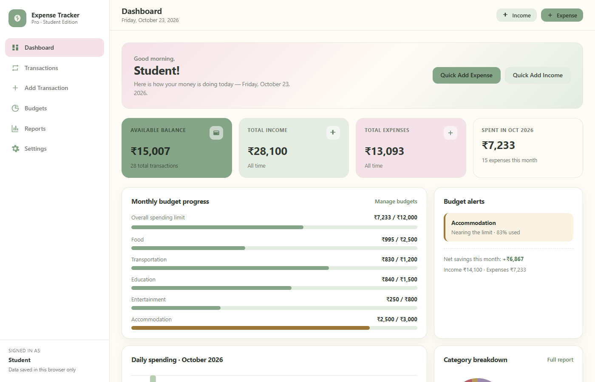
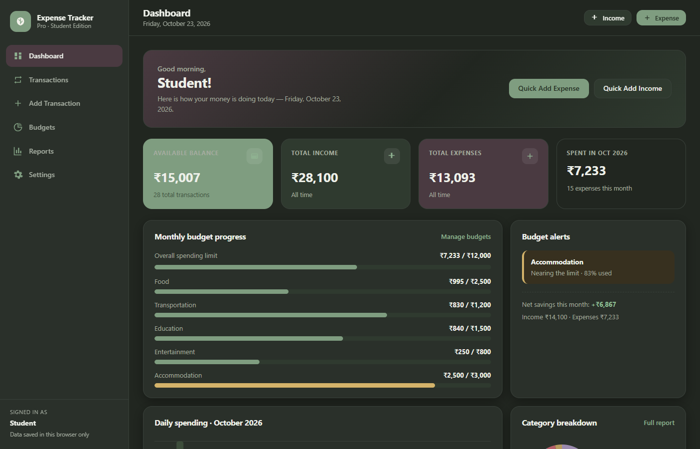
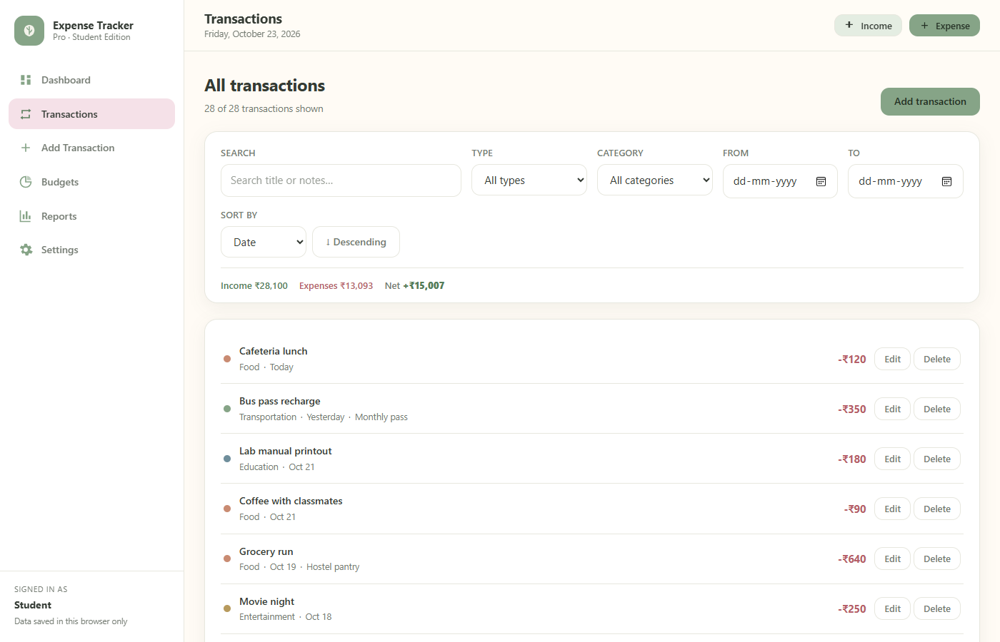
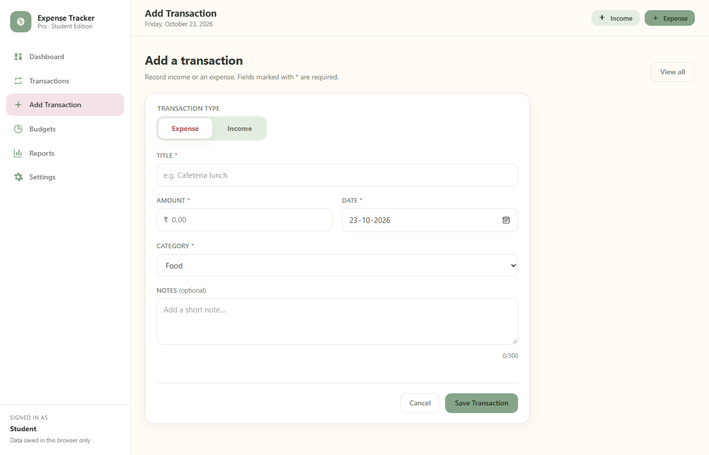
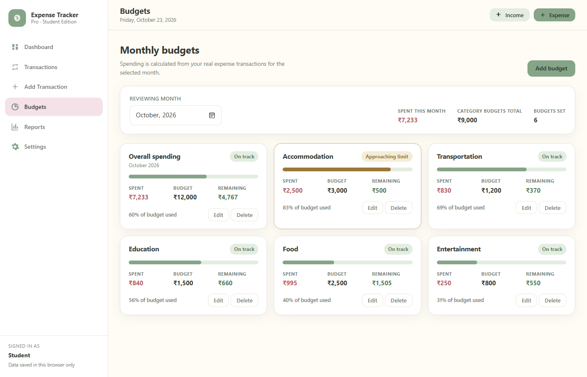
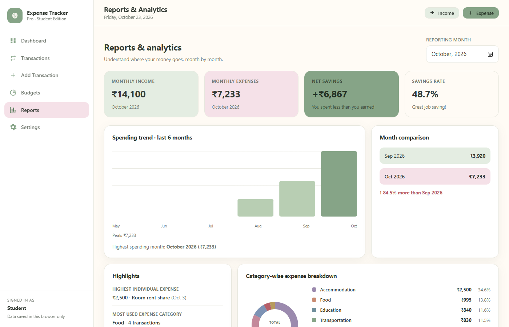
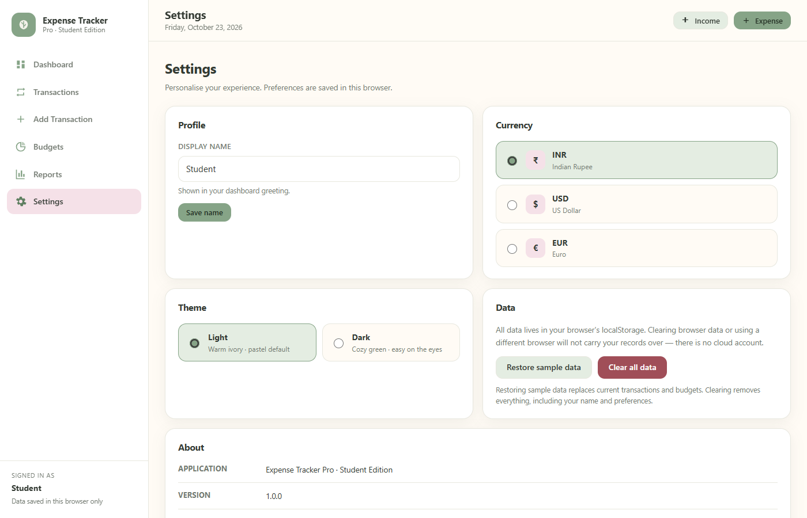
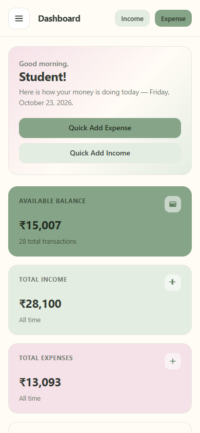
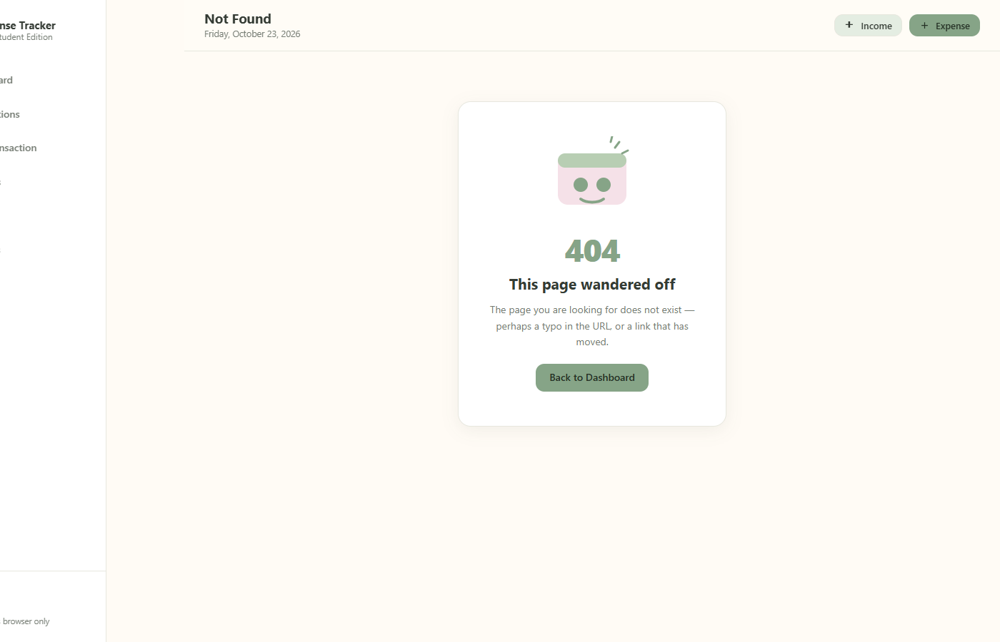

# Expense Tracker Pro — Student Edition

A calm, pastel-themed personal finance journal built with **React** for students who want to
track income, expenses, budgets, and monthly spending habits — right in the browser, with no
backend and no accounts.



---

## 1. Project Abstract

Expense Tracker Pro is a client-side web application that helps college students record and
visualise their daily finances. It implements a complete personal-finance workflow — add
income and expense transactions, categorise them, set monthly budgets, review spending
trends through hand-built CSS/SVG charts, and personalise the experience with currency and
theme preferences. All data is stored in the browser's `localStorage`, so the application
works fully offline and requires no server, database, or API key. The interface uses a
deliberate pastel palette (pastel pink, warm ivory, sage green, forest sage) designed to
feel like an organised journal rather than a corporate banking dashboard.

## 2. Problem Statement

Students frequently struggle to understand where their money goes each month. Common pain
points:

- Pocket money, scholarship, and part-time income arrive in irregular amounts.
- Small daily spends (food, transport, data recharges) accumulate unnoticed.
- Existing finance apps are either overly corporate, ad-heavy, account-gated, or require
  handing personal data to a third party.
- Spreadsheet-based tracking is tedious and offers no visual feedback.

There is a need for a **lightweight, private, visually pleasant expense tracker** that a
student can run locally, understand completely, and extend as a learning project.

## 3. Objectives

1. Build a fully functional expense tracker using HTML5, CSS3, JavaScript (ES6+), and React.
2. Demonstrate core React concepts: functional components, props, `useState`, `useEffect`,
   React Context, and React Router.
3. Persist all user data in `localStorage` with safe handling of missing or corrupted values.
4. Provide accurate financial calculations (balance, monthly totals, savings rate, budget
   utilisation) derived exclusively from real transaction data.
5. Deliver an accessible, responsive, keyboard-navigable UI that works on desktop, tablet,
   and mobile.
6. Implement charts and data visualisations using only CSS, HTML, and SVG — no chart libraries.
7. Apply a consistent pastel design system across every page, with an optional dark theme.

## 4. Scope

**In scope**

- Transaction CRUD (create, read, update, delete) with validation and confirmation dialogs.
- Search, multi-criteria filters (type, category, date range), and sorting.
- Monthly budgets: overall + per-category, with 80 % warning and 100 % exceeded states.
- Monthly reports: income, expenses, net savings, savings rate, category breakdown,
  6-month spending trend, month-over-month comparison, highest expense, top category.
- Settings: display name, currency (INR / USD / EUR), light/dark theme, sample-data restore,
  full data clear.
- Sample demonstration data seeded once on first launch.

**Out of scope (by design)**

- Backend servers, databases, user authentication, cloud sync.
- Real bank feeds, payment integrations, or paid APIs.
- TypeScript, Tailwind, Bootstrap, Material UI, Redux, or any charting library.

## 5. Technologies Used

| Layer        | Technology                                             |
| ------------ | ------------------------------------------------------ |
| Markup       | HTML5 (semantic elements, accessible forms)            |
| Styling      | CSS3 — custom properties, Grid, Flexbox, media queries |
| Logic        | JavaScript ES6+ (modules, destructuring, async/await)  |
| UI library   | React 18 (functional components only)                  |
| State        | `useState`, `useEffect`, `useMemo`, `useCallback`, React Context |
| Routing      | React Router v6                                         |
| Persistence  | Browser `localStorage`                                  |
| Build tool   | Vite 5                                                  |
| Testing      | Node built-in `assert`; Playwright (browser smoke tests) |

## 6. Hardware and Software Requirements

**Hardware (development)**

- Processor: Dual-core 1.6 GHz or better
- RAM: 4 GB minimum (8 GB recommended)
- Storage: ~300 MB for Node.js, project files, and `node_modules`
- Display: 1280 × 720 or higher (responsive down to 360 px)

**Software**

- Windows 10/11, macOS, or Linux
- Node.js ≥ 18 (tested on v22) and npm ≥ 9
- Modern browser: Chrome, Edge, Firefox, or Safari (latest two versions)
- Code editor (VS Code recommended)

## 7. System Architecture

The application follows a **component-based, unidirectional data-flow architecture** with a
single global context as the source of truth.

```
┌─────────────────────────────────────────────────────────────┐
│                        Browser                              │
│  ┌───────────────────────────────────────────────────────┐  │
│  │                      React App                       │  │
│  │                                                       │  │
│  │   AppProvider (Context)                               │  │
│  │   ├─ transactions[]  ◄──── add / update / delete      │  │
│  │   ├─ budgets[]       ◄──── save / delete              │  │
│  │   ├─ profile, settings ◄── update                     │  │
│  │   ├─ toasts[], confirm dialog state                   │  │
│  │   └─ useLocalStorage hook ──► localStorage            │  │
│  │            ▲                                          │  │
│  │            │ props / context consumption              │  │
│  │   React Router pages                                  │  │
│  │   Dashboard · Transactions · AddTransaction           │  │
│  │   Budgets · Reports · Settings · NotFound             │  │
│  │            │                                          │  │
│  │   Reusable components                                 │  │
│  │   Sidebar · Navbar · SummaryCard · TransactionForm    │  │
│  │   TransactionList/Item · BudgetCard · ProgressBar     │  │
│  │   CategoryBreakdown · SpendingChart · ConfirmDialog   │  │
│  │   Toast · EmptyState                                  │  │
│  │            │                                          │  │
│  │   Pure utility modules (no React)                     │  │
│  │   calculations · currency · dateHelpers · validation  │  │
│  │   categories · sampleData                            │  │
│  └───────────────────────────────────────────────────────┘  │
│                          ▲                                  │
│                    localStorage                              │
│  (transactions, budgets, profile, settings, seeded flag)     │
└─────────────────────────────────────────────────────────────┘
```

**Data flow rule:** components never mutate data directly. They call context actions
(`addTransaction`, `saveBudget`, …), which update state; the `useLocalStorage` effect then
persists the new state. Every financial figure on screen is recomputed by pure functions in
`utils/calculations.js` from the current transactions array — nothing is hard-coded.

## 8. Module Descriptions

### 8.1 `src/context/AppContext.jsx`
Global application state via React Context + `useState`. Exposes transactions, budgets,
profile, settings, and actions (add/update/delete transaction, save/delete budget, restore
sample data, clear all data, set currency/theme). Owns toast notifications and the
confirmation-dialog promise mechanism. Validates and sanitises everything read from
`localStorage` so malformed data can never crash the UI. Seeds sample data exactly once on
first launch (tracked with a `seeded` flag).

### 8.2 `src/hooks/useLocalStorage.js`
A generic persistence hook: lazy-initialises state from `localStorage` (tolerating corrupt
JSON), and writes back on every change inside a `useEffect`. Also exports a `readStorage`
helper used for one-time initial reads.

### 8.3 `src/utils/calculations.js`
Pure, testable financial functions: totals by type, monthly aggregation, net savings,
savings rate (returns `null` when income ≤ 0), budget remaining/utilisation/status
(ok ≥ 80 % warning, > 100 % exceeded), category spending, highest individual expense,
most-frequent category, daily expense series, month-over-month comparison, plus generic
filter and sort helpers for the Transactions page.

### 8.4 `src/utils/currency.js`
Locale-aware money formatting via `Intl.NumberFormat` (INR/en-IN, USD/en-US, EUR/en-IE)
with optional signed output and fraction control.

### 8.5 `src/utils/dateHelpers.js`
ISO date utilities: today, month keys (`YYYY-MM`), calendar-accurate month boundaries,
month labels, recent-month lists, strict ISO-date validation (rejects 2026-02-30),
relative day labels ("Today", "Yesterday").

### 8.6 `src/utils/validation.js`
Field-level validation for transactions and budgets. Returns `{ valid, errors, data }`;
checks required fields, positive amounts, ≤ 2 decimal places, category matching the
transaction type, no future dates, no dates before 2000-01-01, positive budget limits.

### 8.7 `src/utils/categories.js`
Canonical category lists (9 expense, 5 income categories), the special `Overall` budget
label, and a muted pastel colour map used by the donut chart and transaction dots.

### 8.8 `src/utils/sampleData.js`
Generates ~28 realistic sample transactions anchored to the current date (so charts are
always meaningful) and six budgets for the current month, plus unique-ID generation.

### 8.9 Pages
| Page               | Responsibility |
| ------------------ | -------------- |
| `Dashboard`        | Greeting, balance/income/expense/month cards, budget progress + alerts, daily spending chart, category donut, recent transactions, quick-add actions, first-use empty state |
| `Transactions`     | Full list with search, type/category/date-range filters, sort by date/amount/title with direction, filtered totals, empty states, edit/delete per row |
| `AddTransaction`   | Reusable form for both create and edit (via `?edit=<id>` and `?type=` query params) with accessible inline validation |
| `Budgets`          | Month selector, overall + per-category budget cards with spent/remaining/usage, add/edit/delete, 80 % and 100 % status handling |
| `Reports`          | Monthly income/expenses/net/savings-rate cards, 6-month SVG bar trend, month comparison, highlights, category donut — all driven by the selected month |
| `Settings`         | Display name, currency, theme, restore sample data, clear all data (both confirmed), about panel |
| `NotFound`         | Friendly 404 with a working link back to the dashboard |

### 8.10 Components
`AppLayout`, `Sidebar` (desktop rail / mobile drawer), `Navbar`, `SummaryCard`,
`TransactionForm`, `TransactionList`, `TransactionItem`, `BudgetCard`, `ProgressBar`,
`CategoryBreakdown` (SVG donut), `SpendingChart` (SVG bar chart), `ConfirmDialog`
(accessible `alertdialog` with focus trap), `Toast`, `EmptyState`.

## 9. Data Structures

```js
// Transaction
{
  id: 'a1b2c3…',            // crypto.randomUUID()
  title: 'Cafeteria lunch', // required, ≤ 80 chars
  amount: 120,              // number, > 0
  type: 'expense',          // 'income' | 'expense'
  category: 'Food',         // must match the type's category list
  date: '2026-10-23',       // ISO yyyy-mm-dd, 2000-01-01 … today
  notes: '',                // optional, ≤ 300 chars
  createdAt: 1761200000000, // epoch ms
  updatedAt: 1761200000000
}

// Budget
{
  id: 'd4e5f6…',
  month: '2026-10',         // yyyy-mm
  category: 'Food',         // or 'Overall'
  limit: 2500               // number, > 0
}

// Profile
{ name: 'Aarav' }

// Settings
{ currency: 'INR', theme: 'light' }   // currency: INR|USD|EUR · theme: light|dark
```

**localStorage keys** (prefix `expenseTrackerPro.`):
`transactions`, `budgets`, `profile`, `settings`, `seeded`.

## 10. Financial Formulas

```
Total Income       = Σ amount of all income transactions
Total Expenses     = Σ amount of all expense transactions
Available Balance  = Total Income − Total Expenses

Monthly Income     = Σ income amounts where month(date) = M
Monthly Expenses   = Σ expense amounts where month(date) = M
Net Savings        = Monthly Income − Monthly Expenses
Savings Rate (%)   = (Net Savings / Monthly Income) × 100     [only if Income > 0]

Budget Remaining   = Budget Limit − Eligible Expenses
Utilisation (%)    = (Eligible Expenses / Budget Limit) × 100 [only if Limit > 0]
  status             ok (< 80 %) · warning (80–100 %) · exceeded (> 100 %)

Category Spending  = Σ expense amounts for category C in month M
```

Guard-rails: income is never counted as an expense; each transaction contributes exactly
once; division by zero returns `null`/`0` instead of `Infinity`/`NaN`; month filtering uses
calendar-correct boundaries (including leap years); historical data is never deleted when
switching months.

## 11. Setup Instructions

```bash
# 1. Install dependencies
npm install

# 2. Start the dev server (hot reload)
npm run dev
# → open http://localhost:5173

# 3. Production build
npm run build        # outputs static files to dist/

# 4. Preview the production build
npm run preview      # → http://localhost:4173

# 5. Run tests
npm test             # calculation & validation unit tests (Node)
npm run test:browser # 33 end-to-end smoke tests (Playwright + system Edge)
```

> **Note:** the `test:browser` script uses Playwright with the system Microsoft Edge/Chrome
> channel, so no separate browser download is required on Windows.

### Deployment (Vercel)

The app is a static SPA and deploys to Vercel with no backend or environment variables:

| Setting | Value |
| ------- | ----- |
| Framework preset | Vite |
| Build command | `npm run build` |
| Output directory | `dist` |
| Install command | `npm install` |

`vercel.json` provides the SPA fallback (`/(.*)` → `/index.html`) so refreshing a nested
route such as `/transactions` or `/reports` never returns a 404.

## 12. Screenshots

| Screen | Preview |
| ------ | ------- |
| Dashboard (light) |  |
| Dashboard (dark) |  |
| Transactions |  |
| Add Transaction |  |
| Budgets |  |
| Reports & Analytics |  |
| Settings |  |
| Mobile dashboard |  |
| Not Found (404) |  |

## 13. Limitations

1. **Single device, single browser.** `localStorage` is scoped to one browser profile on
   one machine; there is no sync, export, or import.
2. **Not secure storage.** Anyone with access to the computer can read or edit the data via
   browser dev-tools. Do not record genuinely sensitive information.
3. **No authentication.** Opening the app shows the data immediately — by design for a
   personal mini-project.
4. **Manual entry only.** No bank statement import, receipt scanning, or recurring
   transactions.
5. **Currency conversion is display-only.** Changing the currency reformats amounts; it does
   not convert values.
6. **Browser capacity.** `localStorage` is typically limited to ~5 MB per origin; thousands
   of transactions would eventually approach that limit.

## 14. Future Scope

- CSV/JSON export and import of transactions.
- Recurring transactions (monthly rent, subscriptions).
- Multi-currency accounts with real exchange rates.
- PWA offline install and push reminders for budget thresholds.
- Optional encrypted sync backend with user accounts.
- Goal-based savings targets with progress rings.
- Receipt photo attachments via the File API.

## 15. Conclusion

Expense Tracker Pro demonstrates that a complete, production-quality personal-finance
experience can be built with nothing more than HTML, CSS, JavaScript, and React — no
backend, no database, no paid services. Every requirement of the mini-project brief is
implemented and verified: seven routed pages, full transaction CRUD with validation,
month-accurate budgets with warning thresholds, SVG/CSS charts, a consistent four-colour
pastel design system with dark mode, robust `localStorage` persistence, accessibility
basics, and responsive layouts. The codebase is deliberately structured into pure utility
modules, a single context provider, and reusable presentational components, making it an
ideal base for learning and extension.

---

*Built as a second-year engineering mini-project using HTML5, CSS3, JavaScript (ES6+),
React, React Router, and Vite. Java is intentionally not used — see `VIVA_QUESTIONS.md`
for the Java vs. JavaScript explanation.*
